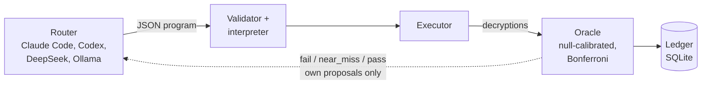

# oracle-router

**Models propose; code disposes.** A multi-model research harness where language models suggest
hypotheses and deterministic, statistically calibrated code decides whether any of them worked.

The test case is a hard, real one: classical-cipher hypotheses for the unsolved pages of the Cicada 3301
*Liber Primus*. The pattern carries over to any search where a candidate can be written down, scored by
code and compared with chance.



## Highlights

- **Trust boundary.** Models only write proposals in a small validated JSON language. They never write
  code and never see scores, thresholds or decrypted text, only a coarse verdict for their own proposals.
- **Calibrated oracle.** Thresholds come from null distributions at the text's exact length and a stated
  false-positive rate. A final Bonferroni check over every attempt on a target makes the binding decision.
- **Multi-model router.** Proposer, triage, weighting and supervisor roles. Per-model USD caps, usage-window
  pacing for plan-based CLIs, and a random-program control arm that every model has to beat.
- **Ledger.** Every hypothesis, attempt and result goes into SQLite, deduplicated, so negative results are
  kept and nothing runs twice.
- **Validated.** Recall and false-positive rate are measured per cipher family and text length, and the
  test suite runs in CI on Linux and Windows.

## Status

On the book's 10 solved sections the harness recovers 9 (7 by brute force alone, 2 more through the program
language; the tenth fails on a corrupted transcription). It has not decrypted any unsolved section, and those
negative results are recorded as results. Numbers and details are in the
[technical write-up](docs/technical.md).

## Quick start

Python 3.11+.

```bash
python -m venv .venv && source .venv/bin/activate      # Windows: .venv\Scripts\Activate.ps1
pip install -e ".[dev]"
pytest
```

No models needed for these:

```bash
oracle-router validate --quick                                              # recall / false-positive smoke run
oracle-router baseline --demo vigenere:120 --ledger demo.sqlite             # brute force on a synthetic target
oracle-router swarm --demo program:120 --generators random_program --rounds 3   # the swarm loop, random control
```

With models: copy `config/models.example.toml` to `config/models.toml`, name the API-key environment
variables there (keys are never stored), and follow [docs/phase3_runbook.md](docs/phase3_runbook.md).
On Windows, `scripts\setup_windows.ps1` sets up the venv, Ollama and local models in one step (same runbook).

## Layout

| Path | What it is |
| --- | --- |
| `src/oracle_router/router/` | Model adapters, roles, budgets, pacing (the only module with network code) |
| `src/oracle_router/swarm/` | Generators, rounds, briefs, coarse feedback |
| `src/oracle_router/programs/` | The JSON cipher-program language |
| `src/oracle_router/oracle/` | Scoring, null calibration, multiple comparisons |
| `src/oracle_router/ledger/`, `executor/` | SQLite ledger; enumeration, dedupe, budgets, stop file |
| `src/oracle_router/validation/` | Recall / false-positive harness and the model tier test |
| `docs/technical.md` | The full write-up |

## Licence

GPL-3.0 (`LICENSE`). Bundled English texts are public-domain books (`src/oracle_router/fixtures/SOURCES.md`);
the Liber Primus transcription in `data/lp/` is third-party material (`data/lp/SOURCES.md`).
